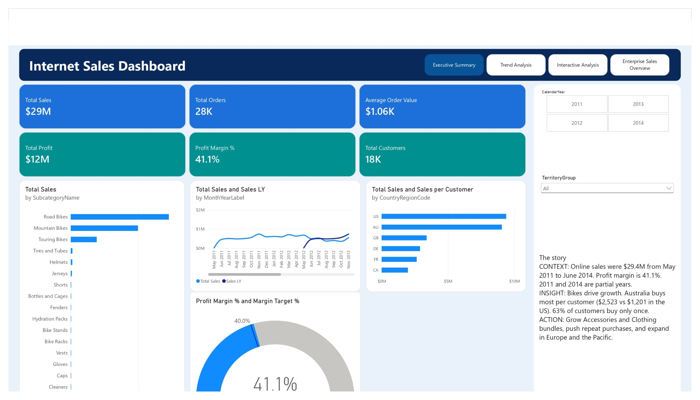
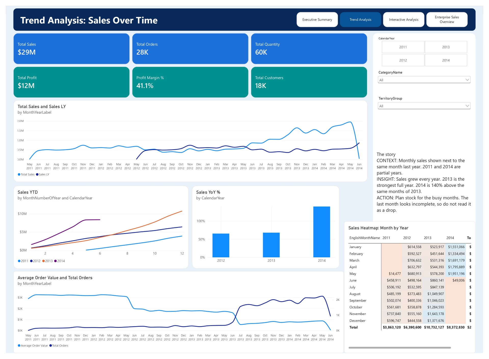
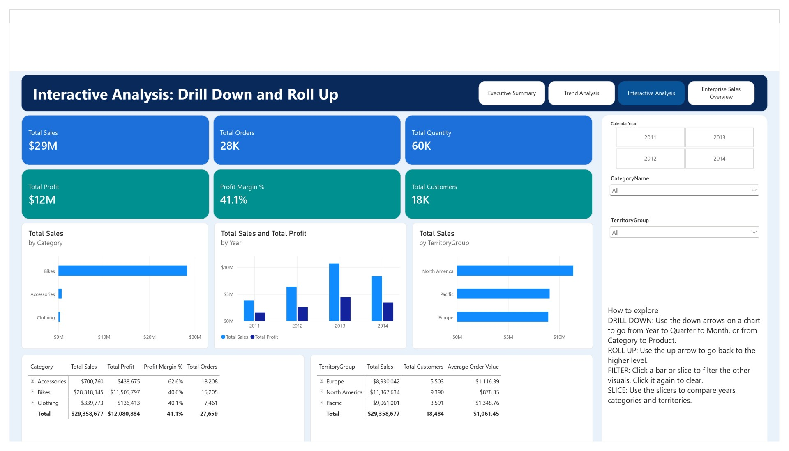
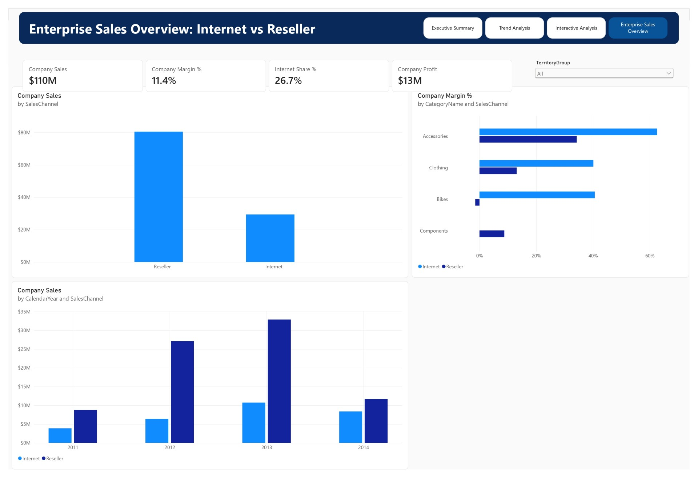

# AdventureWorks | Enterprise Data Warehouse & Business Intelligence

**End-to-End Data Engineering · ETL · Dimensional Modelling · Business Intelligence**

## Project Overview

An end-to-end enterprise data warehousing and business intelligence solution built using Microsoft SQL Server, T-SQL and Power BI.

The project transforms fragmented operational data from the Microsoft AdventureWorks2022 database and external data sources into a unified analytical environment, enabling data-driven decision-making across sales, marketing, purchasing, production and inventory management.

## Business Problem

Highly normalized transactional databases and fragmented enterprise data sources create analytical bottlenecks, making it difficult for stakeholders to monitor revenue trends, assess profitability, evaluate promotional performance and compare sales channels efficiently.

This solution addresses these challenges through a centralized Enterprise Data Warehouse (EDW), repeatable ETL pipelines, dimensional data modelling and interactive business intelligence dashboards.

## Project Highlights

- 120,000+ sales transaction records
- 4 heterogeneous data source formats
- 13 conformed dimension tables
- 8 enterprise fact tables
- 5 departmental data marts
- 7 sequential SQL pipeline scripts
- 38 data quality and reconciliation checks
- 4 interactive Power BI dashboard views

## Technology Stack

| Technology | Application |
|---|---|
| Microsoft SQL Server | Enterprise data warehouse |
| T-SQL | ETL development and data transformation |
| SQL Server Management Studio | Database development and administration |
| Power BI | Business intelligence and visualization |
| VertiPaq | In-memory analytical processing |
| SQL, CSV, JSON, XML | Multi-source data integration |
| Star and Galaxy Schema | Dimensional data modelling |

## Solution Architecture

The solution follows a layered data warehousing architecture:

**Data Sources → Staging Layer → ETL Pipeline → Enterprise Data Warehouse → Data Marts → Power BI Dashboards**

The architecture separates operational data processing from analytical workloads, providing a structured and reusable foundation for enterprise reporting.

All layers live in a single SQL Server database, `AdventureWorks_DW`, separated by schema:

| Schema | Layer |
|---|---|
| `stg` | Staging: raw landing of every source (file columns staged as text so dirty values never break the load) |
| `edw` | Enterprise Data Warehouse: conformed dimensions and all fact tables |
| `etl` | Pipeline control: configuration, execution log, data quality results |
| `dm_internet_sales`, `dm_reseller_sales`, `dm_purchasing`, `dm_production`, `dm_inventory` | Departmental data marts (views over `edw`) |

OLAP is delivered through Power BI's in-memory tabular engine (VertiPaq) over the relational marts, rather than a separate SSAS multidimensional cube.

## Repository Structure

| Path | Contents |
|---|---|
| [`Scripts/`](Scripts/) | The seven T-SQL pipeline scripts, run in numeric order |
| [`Dashboard/DWBI_Internet_Sales_v3.pbix`](Dashboard/DWBI_Internet_Sales_v3.pbix) | Power BI report and data model |
| [`Dashboard/DWBI_Internet_Sales_v3.pdf`](Dashboard/DWBI_Internet_Sales_v3.pdf) | PDF export of the four dashboard pages |
| [`docs/images/`](docs/images/) | Dashboard screenshots used in this README |
| [`DWBI_2026-DS-15_FinalReport.pdf`](DWBI_2026-DS-15_FinalReport.pdf) | Full project report: design, ETL, validation, insights |

## Getting Started

### Prerequisites

- Microsoft SQL Server with the [AdventureWorks2022](https://learn.microsoft.com/sql/samples/adventureworks-install-configure) sample database restored on the same instance
- SQL Server Management Studio (or `sqlcmd`)
- Power BI Desktop, to open the dashboard

### Running the pipeline

Run each script in order in its own SSMS query window:

| # | Script | Runs in | What it does |
|---|---|---|---|
| 1 | `01_Structure_Establishment.sql` | `master` → `AdventureWorks_DW` | Creates the database, schemas, ETL control objects, all EDW tables, constraints and indexes |
| 2 | `02_Format_Differentiator.sql` | `AdventureWorks2022` | Produces the external source files (see below) and an inventory of source tables |
| 3 | `03_Extraction.sql` | `AdventureWorks_DW` | Rebuilds staging and extracts all sources (CSV, JSON, XML, relational) |
| 4 | `04_Data_Profiling.sql` | `AdventureWorks_DW` | Profiles staged data: completeness, statistics, cross-column, cross-table and domain rules |
| 5 | `05_Transform_and_Load.sql` | `AdventureWorks_DW` | Cleanses and loads dimensions, then facts, with logging and rollback |
| 6 | `06_Data_Mart_Establishment.sql` | `AdventureWorks_DW` | Creates the five data mart views |
| 7 | `07_Validation_and_Reconciliation.sql` | `AdventureWorks_DW` | Runs the 38 PASS/FAIL checks and stores results in `etl.DataQualityResult` |

**External source files.** The CSV, JSON and XML files are not included in this repository. Generate them by running the queries in script 02 against `AdventureWorks2022` and saving each result to one folder with these names:

- `Product.csv`, `ProductSubCategory.csv`, `ProductCategory.csv` (save results as CSV, with headers)
- `SalesTerritory.json` (the `FOR JSON` result)
- `Sales.SalesOffers.xml` (the `FOR XML` result)

**Source folder.** Script 03 reads the folder path from `etl.PipelineConfig` rather than from hard-coded paths. Script 01 seeds it with the original development path. Point it at your folder (ending with a backslash) before running script 03:

```sql
UPDATE AdventureWorks_DW.etl.PipelineConfig
SET ConfigValue = N'C:\DWBI_Source\'
WHERE ConfigKey = N'SourceFilePath';
```

The SQL Server service account must be able to read that folder, because `BULK INSERT` and `OPENROWSET` run on the server.

**Re-running.** Script 01 creates objects without existence checks, so drop `AdventureWorks_DW` before running it again. Scripts 03 to 07 can be re-run: staging is rebuilt, dimensions are merged (SCD Type 1), facts are insert-only on their grain, and mart views use `CREATE OR ALTER`. Script 05 must run top to bottom in one session, because a failed step stops all later steps so facts never load against incomplete dimensions.

Each run's progress is recorded in `etl.ExecutionLog`.

## ETL Pipeline

The ETL process is implemented using T-SQL and incorporates:

- Multi-source data extraction and ingestion
- Data profiling and exploratory data quality checks
- Missing value handling and duplicate removal
- Data cleansing and standardization
- JSON and XML parsing
- Surrogate key generation and referential integrity
- Slowly Changing Dimensions (SCD Type 1)
- Transaction-safe loading and rollback mechanisms
- Execution logging and source-to-target reconciliation

## Dimensional Data Modelling

The enterprise data warehouse implements a galaxy schema with shared conformed dimensions, supporting multiple business processes through a centralized analytical model.

Five dependent data marts provide department-specific analytical capabilities:

- Internet Sales
- Reseller Sales
- Purchasing
- Production
- Inventory

## Business Intelligence Dashboards

Interactive Power BI dashboards provide analytical capabilities across four reporting views:

- Internet Sales Executive Summary
- Sales Trend Analysis
- Interactive OLAP Analysis
- Enterprise Sales and Channel Profitability

The dashboards support KPI monitoring, drill-down, roll-up, interactive filtering, historical trend analysis and multidimensional business performance evaluation.

### Dashboard Preview

**Executive Summary:** headline KPIs, sales by subcategory and country, and profit margin against a 40% target.



**Trend Analysis:** monthly sales against the same month last year, year-to-date growth, YoY %, and a month-by-year heatmap.



**Interactive Analysis:** drill-down and roll-up by category, year and territory, with synced slicers.



**Enterprise Sales Overview:** internet and reseller channels compared on sales, margin and annual trend.



The Power BI model imports the `dm_internet_sales` mart, plus the enterprise sales fact (both channels) for the channel profitability page. It includes:

- 30+ DAX measures, including KPIs (sales, profit, margin, orders, customers, average order value), time intelligence (prior year, YoY %, YTD, MoM %, 3-month average), repeat-customer analysis and enterprise channel measures
- Date (Year → Quarter → Month → Day), Product (Category → Subcategory → Product) and Territory (Group → Country → Region) hierarchies for drill-down and roll-up
- A product drill-through page and a report page tooltip

To refresh it against your own server, open the `.pbix` and update the SQL Server connection under *Transform data → Data source settings*.

**Headline figures (internet channel, May 2011 to June 2014):** $29.4M sales, $12.1M gross profit, 41.1% margin, 27,659 orders, 18,484 customers and a $1,061 average order value. Across both channels the business sold $110M at an 11.4% margin.

## Key Business Insights

- **Revenue concentration:** Bicycle sales account for approximately 96% of internet sales revenue.
- **Product profitability:** Accessories achieve a 62.6% profit margin, highlighting cross-selling and bundling opportunities.
- **Sales growth:** Annual internet sales increased by approximately 68% between 2012 and 2013.
- **Channel profitability:** Internet sales contribute approximately 90% of enterprise gross profit despite representing only 26.7% of total revenue.
- **Customer behaviour:** Regional differences in customer spending and average order value reveal opportunities for targeted marketing.
- **Pricing optimization:** Negative margins in reseller bicycle sales highlight the need to reassess wholesale pricing and discount strategies.

**Data limitations:** 2011 (May to December) and 2014 (January to June) are partial years, and June 2014 is an incomplete month, so the final point on time-series charts is artificially low. Enterprise figures ($110M) cover both channels and will differ from the internet-only pages ($29M).

The full analysis, with the recommendation behind each insight, is in the [final report](DWBI_2026-DS-15_FinalReport.pdf).

## Data Quality & Validation

A suite of 38 validation and reconciliation checks was developed to verify:

- Source-to-target record count consistency
- Financial reconciliation
- Primary and foreign key integrity
- Duplicate prevention
- Data completeness
- Business rule compliance

All 38 checks pass on the delivered build. Results are written to `etl.DataQualityResult` with a computed PASS/FAIL status.

## Skills Demonstrated

Data Engineering · SQL Development · ETL Pipeline Development · Data Warehousing · Dimensional Modelling · Data Integration · Data Profiling · Data Transformation · Business Intelligence · Data Visualization · OLAP Analysis · KPI Reporting · Business Analytics · Data Quality Management

## Dataset

Microsoft AdventureWorks2022 OLTP Database, supplemented with external CSV, JSON and XML datasets to simulate a heterogeneous enterprise data environment.

## Project Information

Developed collaboratively as part of the Data Warehousing and Business Intelligence module (IT3101), Year 3, Data Science Specialization, Sri Lanka Institute of Information Technology (SLIIT), 2026.